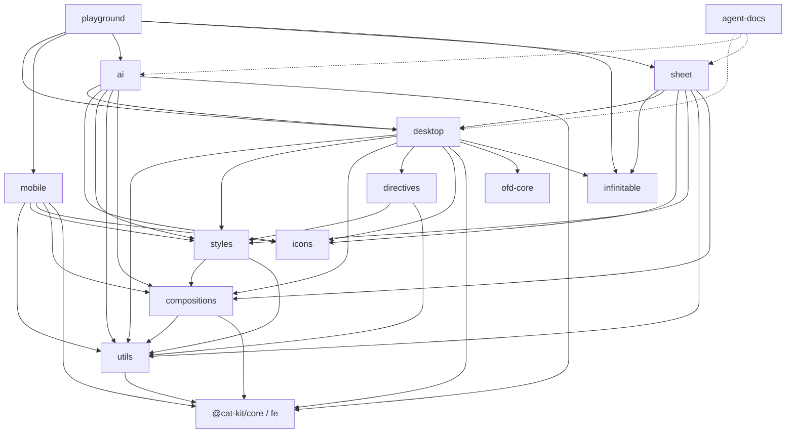

# 代码地图

包内分层与 API 细节读各包 `AGENTS.md`，不要把本文件当文件清单。

## 树

```
ultra-ui/
├── packages/                 # 可发布或占位的库包
│   ├── utils/                # @veltra/utils 工具与共享类型
│   ├── styles/               # @veltra/styles SCSS + theme
│   ├── compositions/         # @veltra/compositions
│   ├── directives/           # @veltra/directives
│   ├── desktop/              # @veltra/desktop 桌面组件主包
│   │   └── src/components/   # 一目录一组件（index.ts + style.ts）
│   ├── sheet/                # @veltra/sheet Vue 电子表格编辑器
│   │   └── src/{components,tools,types}/
│   ├── ai/                   # @veltra/ai
│   │   └── src/{chat,components,providers,tools,types}/
│   ├── ofd-core/             # @veltra/ofd-core 零依赖 OFD 解析渲染内核，不发版（打包进 desktop）
│   ├── icons/                # @veltra/icons（vue/ 为生成物）
│   └── mobile/               # @veltra/mobile 移动端组件库（同名组件为主、API 按 NutUI 惯例可分叉）
├── playground/               # 预览应用 + 参考服务
│   ├── src/                  # desktop / mobile / icons / ai / sheet 演示页
│   └── server/               # 填报存取 + DeepSeek 代理 + 智慧表格 + AI 建模内存库（同端口 7799）
├── scripts/                  # 发版、样式跟随校验、docs-mcp 推送、git 本地配置
├── agent-docs/               # 面向 docs-mcp 的检索文档，docs-gen 技能撰写、push-docs.mjs 推送
├── .agents/                  # Agent 文档与工程脚本
├── .changeset/               # 版本策略与 changeset 文件
└── vite.config.ts            # monorepo 级 test / lint / fmt / run / staged
```

## 模块

| 模块         | 路径                    | 职责                                                                                         | 主要入口                                                                   |
| ------------ | ----------------------- | -------------------------------------------------------------------------------------------- | -------------------------------------------------------------------------- |
| utils        | `packages/utils`        | 工具函数、BEM helper、共享类型；无 Vue 组件                                                  | `src/index.ts`                                                             |
| styles       | `packages/styles`       | SCSS mixins/vars/functions、normalize/transitions/animations、主题 TS                        | `src/_mixins.scss`、`src/theme/index.ts`                                   |
| compositions | `packages/compositions` | Vue 组合式函数（useModel / usePop / useConfig 等）                                           | `src/index.ts`（各 `use-*`）                                               |
| directives   | `packages/directives`   | `vFocus` / `vClickOutside` / `vRipple`                                                       | `src/index.ts`                                                             |
| desktop      | `packages/desktop`      | 桌面端 UI 主包；`install` 全局注册                                                           | `src/index.ts`、`src/install.ts`                                           |
| sheet        | `packages/sheet`        | USheet、工具系统（模型/命令/公式/IO/SheetGrid 直取 npm 包 `infinitable` 的 `/sheet` 子路径） | `src/index.ts`                                                             |
| ai           | `packages/ai`           | UAiChat / useChat / transport                                                                | `src/index.ts`                                                             |
| ofd-core     | `packages/ofd-core`     | 零依赖 OFD（GB/T 33190）解析渲染内核，SVG 页面输出；private 不发版，打包进 desktop           | `src/index.ts`                                                             |
| icons        | `packages/icons`        | SVG → Vue 图标                                                                               | `src/index.ts`、`src/normal.ts`、`src/colorful.ts`                         |
| mobile       | `packages/mobile`       | 移动端组件库，同名组件为主、API 按 NutUI 移动惯例允许分叉，做移动端密度/触控适配             | `src/index.ts`                                                             |
| playground   | `playground`            | 预览 SPA（desktop / mobile 演示）+ 填报/AI 参考实现                                          | `src/main.ts`、`playground/server/dev.ts`                                  |
| scripts      | `scripts`               | 样式跟随校验、docs 推送、release、setup-git                                                  | `check-component-styles.ts`、`push-docs.mjs`、`release.ts`、`setup-git.ts` |
| agent-docs   | `agent-docs`            | 面向 docs-mcp 的检索文档，docs-gen 技能撰写、`push-docs.mjs` 推送                            | `index.md`、各包目录 `*.md`                                                |

## 依赖



虚线：生成/文档依赖（skill、agent-docs）。

## 关键路径

1. **宿主按需组件**：显式 `import { U* } from '@veltra/<pkg>'`；组件 SFC 各自 `import './style'`，样式经 `sideEffects` 与组件同粒度 tree-shake（`@veltra/vite` resolver 已废弃）。仓库根 `bun run style:check` 校验约定。
2. **playground 启动**：`cd playground && bun run dev` 同时拉起前端 7788 与参考服务 7799（填报 + `/ai` + `/smart-table` + `/ai-db`）。
3. **发版**：统一走发版技能 `.agents/skills/release`（changeset → `bun run release` → CI publish）。
4. **检索文档同步**：`agent-docs/` 由 docs-gen 技能按源码现状撰写，用 `node scripts/push-docs.mjs` 全量推送到 docs 服务。
